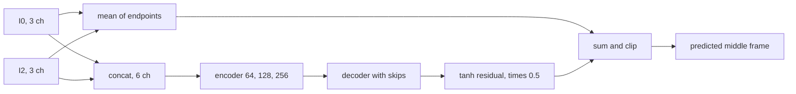
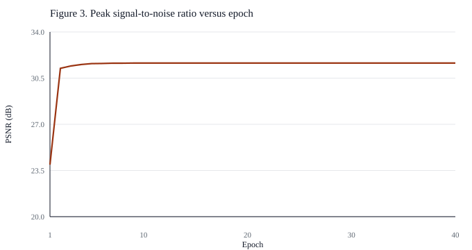
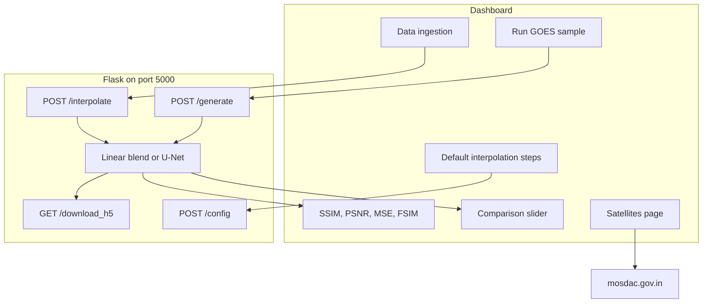

# Seamless SAT Frames

Temporal super-resolution of geostationary thermal imagery. Given two brightness-temperature frames, the system estimates the unobserved frame that falls between them, so a 30-minute INSAT cadence can be read at 15 minutes and, by recursion, at 7.5 minutes.

[](https://www.python.org/)
[](https://pytorch.org/)
[](https://flask.palletsprojects.com/)
[](https://react.dev/)
[](LICENSE)

## Run a real satellite example

The [pipeline notebook](Seamless_SAT_Frames_Pipeline.ipynb) runs both methods, evaluates them against the observed midpoint, and exports the results.

Start both services from the repository root in separate PowerShell terminals.

Backend:

```powershell
cd dashboard\backend
python -m venv .venv
.\.venv\Scripts\python.exe -m pip install -r requirements.txt
.\.venv\Scripts\python.exe server.py
```

Frontend:

```powershell
cd dashboard\frontend
npm.cmd ci
npm.cmd run dev
```

For a 30-minute test, open [the dashboard](http://localhost:5173), select **Milton**, and click **Run Hurricane Milton**. The three fixed-grid crops are NOAA GOES-16 ABI Channel 13 observations of Hurricane Milton on 9 October 2024 at 18:01, 18:16, and 18:31 UTC. They use a shared 180?330 K intensity scale and the same 384 ? 384 crop. The **Change between observations** layer shows the pixel differences between the endpoints. [NOAA archive, 18 UTC](https://noaa-goes16.s3.amazonaws.com/?list-type=2&prefix=ABI-L2-CMIPC%2F2024%2F283%2F18%2F)

Open [the dashboard](http://localhost:5173) and select **GOES-18**, and click **Run GOES sample**. Linear blend is the default. Select **U-Net (experimental)** to use the bundled GOES-18 starter checkpoint built with the [reference residual U-Net architecture](https://github.com/pradhan-not-found/ISRO/blob/main/backend/model.py). It uses three bundled GOES-18 ABI Channel 13 thermal infrared observations from NOAA for 1 January 2024, in the 12:00, 12:10 and 12:20 UTC scans. The first and last observations are inputs and the actual middle observation is held out for evaluation. The midpoint lies 10 minutes after the first observation. Choosing **Midpoint and quarters** generates frames at offsets of 5, 10 and 15 minutes.

For your own data, select the first and last co-registered thermal infrared PNG or JPEG observations. Use the same area, band, dimensions and intensity scale. The server scales larger triplets together to a working grid up to 768 pixels on the longer side. The viewer and HDF5 metadata report the input dimensions, and exports use the working grid. Identical endpoints produce an unchanged sequence. Enter the time between the two observations. For 30-minute INSAT endpoints the modes produce a 15-minute midpoint or three predictions at 7.5, 15 and 22.5 minutes. Supply the observed midpoint when you have one to see evaluation metrics. Play or scrub through the observation sequence. Switch layers to see the linear midpoint, the difference from that blend, predicted edges, or the absolute error when an observed midpoint is available. **PNG** downloads the selected layer or frame. **HDF5** exports the latest predictions with their relative time offsets.

## Abstract

Geostationary imagers observe the same disc on a fixed clock. INSAT-3DS and INSAT-3DR thermal infrared frames arrive every 30 minutes. GOES-19 ABI and Himawari-8 are faster, at about 10 minutes, which makes them the natural place to learn a middle frame that can later be checked. Cloud motion in this band is non-rigid: cells rotate, merge, split, and decay, so a displacement borrowed from rigid optical flow smears the cold cores that matter for cyclones, convective outbreaks, and fire fronts.

This repository is the working system for that problem. A six-channel temporal U-Net predicts a residual on top of the linear blend of the two endpoints. Linear blend is the default. The experimental U-Net is selectable when a trained checkpoint is available. Evaluation is against the held-out middle frame with SSIM, PSNR, MSE, and FSIM.

## 1. Problem

Let \(I_0\) and \(I_2\) be consecutive thermal frames and \(I_1\) the unobserved frame at the midpoint. The estimator is

\[
\hat{I}_1 = \mathrm{clip}\left(\frac{I_0 + I_2}{2} + \Delta_\theta(I_0, I_2)\right)
\]

where \(\Delta_\theta\) is a residual in \([-0.5, 0.5]\) after a \(\tanh\) gate. A second pass, \(\hat{I}_{0.5} = f_\theta(I_0, \hat{I}_1)\) and \(\hat{I}_{1.5} = f_\theta(\hat{I}_1, I_2)\), produces the 7.5-minute samples. INSAT has no observation at those times, so the quantitative test is reserved for GOES-19 and Himawari-8, where a real middle frame exists.

| Source | Band | Cadence | Role |
| --- | --- | --- | --- |
| GOES-19 ABI Channel 13 | ~10.3 µm | 10 min | Train and test. The middle frame is ground truth. |
| Himawari-8 | thermal infrared | 10 min | Second basin, same protocol. |
| INSAT-3DS / 3DR TIR1 | ~10.8 µm | 30 min | Deployment target. No finer ground truth. |

## 2. Method

### 2.1 Triplets

Raw NetCDF or HDF5 radiances are read in time order. The thermal field is scaled to 8-bit, and a fixed 512×512 window is cut from the disc centre so every frame shares a grid. Training samples are overlapping triplets \((I_t, I_{t+2}, I_{t+1})\): the network sees the endpoints and is scored on the skipped frame.

### 2.2 Network

Each grayscale frame is repeated to three channels. The two endpoints are concatenated to a 6-channel tensor and passed through a U-Net: two convolutions per stage, batch norm, ReLU, two downsamples, and two transposed upsamples with skip connections. The last 1×1 convolution emits three channels. Those channels are not the image. They are a bounded motion residual added to the average of the inputs.



### 2.3 Objective

`dashboard/backend/train.py` minimises the L1 distance to the true middle frame. L1 is used instead of L2 because squared error rewards the blurry average that this task is trying to leave behind. The optimiser is Adam at \(10^{-4}\), batch size 1, for 200 epochs. Custom weights are written to `models/satellite_interpolator.pth` and take priority over the bundled starter checkpoint.

The curves below are that same L1 criterion, measured on a controlled 128×128 thermal patch whose middle frame is known. A scalar blend weight is descended for 40 epochs from a poor initialisation. This is not a reported GOES-19 test of the full U-Net. It is the shape of the objective the trainer minimises: a steep drop, then a plateau once the blend sits on the linear reference (dashed line, L1 = 5.89).

<p align="center">
  
</p>

SSIM on the same patch rises from 0.930 to 0.987 and stays there. PSNR rises from 23.9 dB to 31.6 dB. Both flatten together with the loss, which is what a converged interpolator should do when the residual has nothing left to explain on a smooth field.

<p align="center">
  
  <br>
  
</p>

| Epoch | L1 | SSIM | PSNR (dB) |
| ---: | ---: | ---: | ---: |
| 1 | 13.61 | 0.930 | 23.94 |
| 2 | 6.08 | 0.985 | 31.24 |
| 5 | 5.91 | 0.986 | 31.60 |
| 10 | 5.88 | 0.987 | 31.64 |
| 40 | 5.88 | 0.987 | 31.64 |
| Linear blend | 5.89 | 0.986 | 31.63 |

On this smooth patch the learned blend ties the linear baseline, as it should. The U-Net residual exists for the other case: non-rigid cloud motion, where the average is blurred and the residual has to put the cold core back.

### 2.4 What the server does at inference

1. Decode the two endpoints as grayscale.
2. When U-Net is selected, run the loaded checkpoint. A `resolution=7.5min` request runs two further passes.
3. For linear interpolation, weight the original endpoints directly at the requested fraction.
4. Build an absolute-difference heatmap against the linear blend, and a Sobel magnitude of the prediction.
5. If the run includes an observed midpoint, score the prediction and linear blend against it.
6. Write `data/latest_prediction.h5`.

## 3. System

The dashboard is a client of one Flask process. The Satellites page uses a read-only Flask adapter for the public ISRO MOSDAC gallery. It requests the current IST date, checks for updates every five minutes, and shows source timestamps for INSAT, radar, and forecast products. The LIVE tab links to the official map.



| Route | Caller | Body | Returns |
| --- | --- | --- | --- |
| `POST /interpolate` | Upload | `frame1`, `frame3`, optional `midpoint`, `endpoint_gap` in minutes, and `resolution`, optional `method` | Predictions, analysis images, optional evaluation |
| `POST /generate` | Run GOES sample | Optional `resolution`, `method`, and `source` (`sample`, `milton`, or `processed`) | Same payload |
| `GET` or `POST /config` | Model configuration | Default interpolation steps | Saved steps and U-Net availability |
| `GET /download_h5` | Export | ? | `interpolated_t1.h5` for the latest run |

The API defaults to `method: "linear"`. Set `method: "u-net"` to request the experimental checkpoint. The API retains the mode values `15min` and `7.5min` for midpoint and quarter steps. Actual output timing depends on the input gap. Uploads leave the bundled and locally prepared frames intact.

The Vite dev server proxies `/interpolate`, `/generate`, `/config`, `/download_h5`, and `/feeds/mosdac` to Flask at `127.0.0.1:5000`.

## 4. Evaluation

Four numbers are reported for the prediction and for the linear blend.

| Metric | Definition used here | Better |
| --- | --- | --- |
| MSE | Mean squared error on 8-bit pixels | Lower |
| PSNR | \(10 \log_{10}(255^2 / \mathrm{MSE})\) | Higher |
| SSIM | Structural similarity. Local Gaussian-window SSIM on 8-bit grayscale. | Higher |
| FSIM | Feature similarity. `piq.fsim` when the trained PyTorch engine and PIQ are available. | Higher |

The dashboard reports prediction and linear-blend scores against the observed midpoint. For input pairs without a middle observation, the visual diagnostics are available and the evaluation stays empty.

## 5. Repository

```
seamless-sat-frames/
├── dashboard/
│   ├── backend/
│   │   ├── server.py            # Flask API, metrics, HDF5 export
│   │   ├── model.py             # temporal U-Net
│   │   ├── train.py             # Adam, L1, 200 epochs
│   │   ├── dataset.py           # (I_t, I_{t+2}, I_{t+1}) loader
│   │   ├── preprocess.py        # NetCDF thermal patch extraction
│   │   └── download_sample.py   # GOES ABI channel 13 sample
│   └── frontend/                # React dashboard
├── docs/figures/                # Figures 1–3
└── README.md
```

The bundled GOES triplet and starter checkpoint are in `dashboard/backend/sample`. Raw training data, custom checkpoints, and HDF5 exports are kept locally.

## 6. Reproduce the GOES sample and train

From `dashboard/backend`, use the virtual environment created above:

```powershell
.\.venv\Scripts\python.exe -m pip install xarray netCDF4
.\.venv\Scripts\python.exe download_sample.py
.\.venv\Scripts\python.exe preprocess.py
```

These scripts download the first three GOES-18 ABI Channel 13 full-disk scans from the public NOAA archive prefix `noaa-goes18/ABI-L1b-RadF/2024/001/12/` and prepare the centre crops in `data/processed`. Raw Himawari Standard Data archives (`.DAT.bz2`) require an HSD reader and thermal calibration before they can be exported for upload.

### Starter checkpoint provenance

The upstream ISRO repository provides the model code and training loop. The bundled weights here were trained on NOAA GOES-18 ABI Channel 13 observations. Training used six scans from 11:00?11:50 UTC on each of 2 and 4 January 2024, with shared 64-pixel crops sampled from eight temporal triplets. The 1 January dashboard triplet was excluded from training. This small checkpoint demonstrates end-to-end inference. Its output is exploratory and its accuracy on INSAT or Himawari has yet to be established.

Reproduce the starter from `dashboard/backend` after installing the preprocessing packages above:

```powershell
.\.venv\Scripts\python.exe download_sample.py --date 2024-01-02 --hour 11 --count 6 --output data/training/raw/002
.\.venv\Scripts\python.exe download_sample.py --date 2024-01-04 --hour 11 --count 6 --output data/training/raw/004
.\.venv\Scripts\python.exe preprocess.py --raw-dir data/training/raw/002 --output data/training/processed/002
.\.venv\Scripts\python.exe preprocess.py --raw-dir data/training/raw/004 --output data/training/processed/004
.\.venv\Scripts\python.exe train.py --data-dir data/training/processed/002 data/training/processed/004 --epochs 4 --steps 80 --patch-size 64 --seed 42 --cpu
```

Restart Flask after training to load the new checkpoint.

## License

MIT. See [LICENSE](LICENSE).
