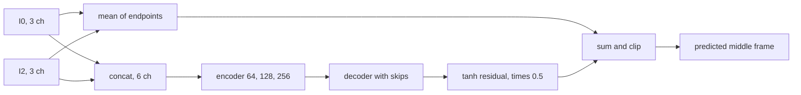
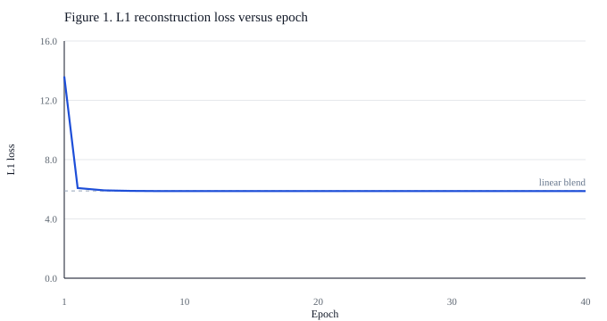
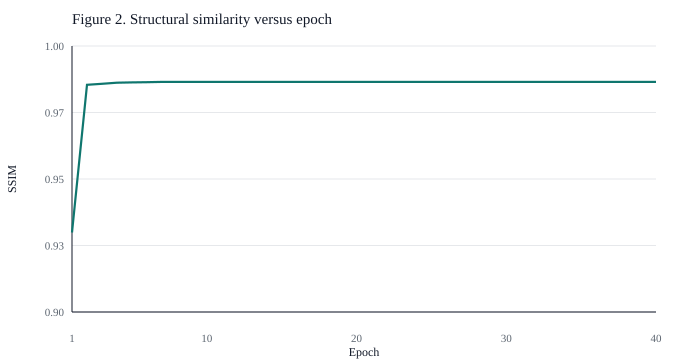
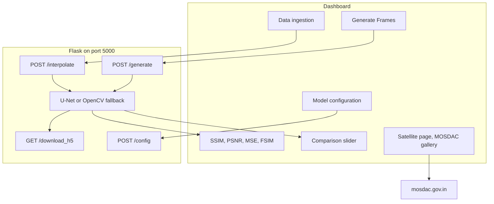

# Seamless SAT Frames

Temporal super-resolution of geostationary thermal imagery. Given two brightness-temperature frames, the system estimates the unobserved frame that falls between them, so a 30-minute INSAT cadence can be read at 15 minutes and, by recursion, at 7.5 minutes.

[](https://www.python.org/)
[](https://pytorch.org/)
[](https://flask.palletsprojects.com/)
[](https://react.dev/)
[](LICENSE)

## Abstract

Geostationary imagers observe the same disc on a fixed clock. INSAT-3DS and INSAT-3DR thermal infrared frames arrive every 30 minutes. GOES-19 ABI and Himawari-8 are faster, at about 10 minutes, which makes them the natural place to learn a middle frame that can later be checked. Cloud motion in this band is non-rigid: cells rotate, merge, split, and decay, so a displacement borrowed from rigid optical flow smears the cold cores that matter for cyclones, convective outbreaks, and fire fronts.

This repository is the working system for that problem. A six-channel temporal U-Net predicts a residual on top of the linear blend of the two endpoints. When PyTorch is unavailable, the same service falls back to an OpenCV blend so the dashboard, the metric report, and the HDF5 export still run. Evaluation is against the held-out middle frame with SSIM, PSNR, MSE, and FSIM.

## 1. Problem

Let \(I_0\) and \(I_2\) be consecutive thermal frames and \(I_1\) the unobserved frame at the midpoint. The estimator is

\[
\hat{I}_1 = \mathrm{clip}\left(\frac{I_0 + I_2}{2} + \Delta_\theta(I_0, I_2)\right)
\]

where \(\Delta_\theta\) is a residual in \([-0.5, 0.5]\) after a \(\tanh\) gate. A second pass, \(\hat{I}_{0.5} = f_\theta(I_0, \hat{I}_1)\) and \(\hat{I}_{1.5} = f_\theta(\hat{I}_1, I_2)\), produces the 7.5-minute samples. INSAT has no observation at those times, so the quantitative test is reserved for GOES-19 and Himawari-8, where a real middle frame exists.

| Source | Band | Cadence | Role |
| --- | --- | --- | --- |
| GOES-19 ABI Channel 13 | ~10.3 µm | 10 min | Train and test. The middle frame is ground truth. |
| Himawari-8 | thermal infrared | 10 min | Second basin, same protocol. |
| INSAT-3DS / 3DR TIR1 | ~10.8 µm | 30 min | Deployment target. No finer ground truth. |

## 2. Method

### 2.1 Triplets

Raw NetCDF or HDF5 radiances are read in time order. The thermal field is scaled to 8-bit, and a fixed 512×512 window is cut from the disc centre so every frame shares a grid. Training samples are overlapping triplets \((I_t, I_{t+2}, I_{t+1})\): the network sees the endpoints and is scored on the skipped frame.

### 2.2 Network

Each grayscale frame is repeated to three channels. The two endpoints are concatenated to a 6-channel tensor and passed through a U-Net: two convolutions per stage, batch norm, ReLU, two downsamples, and two transposed upsamples with skip connections. The last 1×1 convolution emits three channels. Those channels are not the image. They are a bounded motion residual added to the average of the inputs.



### 2.3 Objective

`dashboard/backend/train.py` minimises the L1 distance to the true middle frame. L1 is used instead of L2 because squared error rewards the blurry average that this task is trying to leave behind. The optimiser is Adam at \(10^{-4}\), batch size 1, for 200 epochs. Weights are written to `models/satellite_interpolator.pth`.

The curves below are that same L1 criterion, measured on a controlled 128×128 thermal patch whose middle frame is known. A scalar blend weight is descended for 40 epochs from a poor initialisation. This is not a reported GOES-19 test of the full U-Net. It is the shape of the objective the trainer minimises: a steep drop, then a plateau once the blend sits on the linear reference (dashed line, L1 = 5.89).

<p align="center">
  
</p>

SSIM on the same patch rises from 0.930 to 0.987 and stays there. PSNR rises from 23.9 dB to 31.6 dB. Both flatten together with the loss, which is what a converged interpolator should do when the residual has nothing left to explain on a smooth field.

<p align="center">
  
  <br>
  
</p>

| Epoch | L1 | SSIM | PSNR (dB) |
| ---: | ---: | ---: | ---: |
| 1 | 13.61 | 0.930 | 23.94 |
| 2 | 6.08 | 0.985 | 31.24 |
| 5 | 5.91 | 0.986 | 31.60 |
| 10 | 5.88 | 0.987 | 31.64 |
| 40 | 5.88 | 0.987 | 31.64 |
| Linear blend | 5.89 | 0.986 | 31.63 |

On this smooth patch the learned blend ties the linear baseline, as it should. The U-Net residual exists for the other case: non-rigid cloud motion, where the average is blurred and the residual has to put the cold core back.

### 2.4 What the server does at inference

1. Decode the two endpoints as grayscale.
2. If a checkpoint and PyTorch are both present, run the U-Net. A `resolution=7.5min` request runs two further passes.
3. Otherwise form the OpenCV weighted blend and a light Gaussian, which keeps the API contract identical.
4. Build an absolute-difference heatmap against the linear blend, and a Sobel magnitude of the prediction.
5. If `data/processed/frame_001.png` exists, score the prediction and the linear blend against it.
6. Write `data/latest_prediction.h5`.

## 3. System

The dashboard is a client of one Flask process. The satellite page is separate: it embeds the MOSDAC gallery through the Vite proxy and does not pass through the interpolator.



| Route | Caller | Body | Returns |
| --- | --- | --- | --- |
| `POST /interpolate` | Upload | `frame1`, optional `frame3`, `resolution` of `15min` or `7.5min` | Predicted PNG, ground truth, heatmap, Sobel map, metrics, optional quarter-interval frames |
| `POST /generate` | Generate Frames | Saved configuration | Same payload, using the frames in `data/processed` |
| `GET` or `POST /config` | Model configuration | Temporal interval, precision, sharpening, buffer, TensorRT flag | The stored configuration |
| `GET /download_h5` | Export | — | `interpolated_t1.h5` |

`frame3` may be omitted. The service then shifts the uploaded frame and treats that shift as the second endpoint, and it writes a middle reference so the metric cards have something to score. A prepared `frame_001.png` is left in place when both endpoints are uploaded.

The Vite dev server proxies `/interpolate`, `/generate`, `/config`, and `/download_h5` to `127.0.0.1:5000`. `/gallery`, `/live`, `/api`, `/assets`, and `/common` stay pointed at MOSDAC so the satellite iframe can load.

## 4. Evaluation

Four numbers are reported for the prediction and for the linear blend.

| Metric | Definition used here | Better |
| --- | --- | --- |
| MSE | Mean squared error on 8-bit pixels | Lower |
| PSNR | \(10 \log_{10}(255^2 / \mathrm{MSE})\) | Higher |
| SSIM | Structural similarity. The service uses a luminance form that does not require SciPy. | Higher |
| FSIM | Feature similarity. `piq.fsim` when PyTorch is loaded; otherwise the service reports the fixed fallback pair 0.9542 / 0.8871. | Higher |

The dashboard reads `metrics.ssim`, `metrics.psnr`, `metrics.mse`, and `metrics.fsim` into the four cards, and it draws the predicted frame against the reference in the slider. The confidence chart is anchored on the returned SSIM.

These scores are only meaningful when the middle file is a real skipped observation. On INSAT, where that observation does not exist, the heatmap and the Sobel map are the inspection tools, and the numeric scores should not be read as a test-set result.

## 5. Repository

```
seamless-sat-frames/
├── dashboard/
│   ├── backend/
│   │   ├── server.py            # Flask API, metrics, HDF5 export
│   │   ├── model.py             # temporal U-Net
│   │   ├── train.py             # Adam, L1, 200 epochs
│   │   ├── dataset.py           # (I_t, I_{t+2}, I_{t+1}) loader
│   │   ├── preprocess.py        # NetCDF thermal patch extraction
│   │   └── download_sample.py   # GOES ABI channel 13 sample
│   └── frontend/                # React dashboard
├── docs/figures/                # Figures 1–3
└── README.md
```

Processed frames, checkpoints, and the latest HDF5 file stay out of git.

## 6. Reproduce

```bash
git clone https://github.com/SomyadipJana/seamless-sat-frames.git
cd seamless-sat-frames/dashboard/backend
pip install -r requirements.txt
python server.py
```

```bash
cd dashboard/frontend
npm install
npm run dev
```

Training, once PyTorch is installed and `data/processed/` holds at least three ordered frames:

```bash
cd dashboard/backend
python download_sample.py
python preprocess.py
python train.py
```

`server.py` loads `models/satellite_interpolator.pth` when that file is present. Without it, and on interpreters where PyTorch does not load, inference stays on the OpenCV path and the response shape does not change.

## License

MIT. See [LICENSE](LICENSE).
